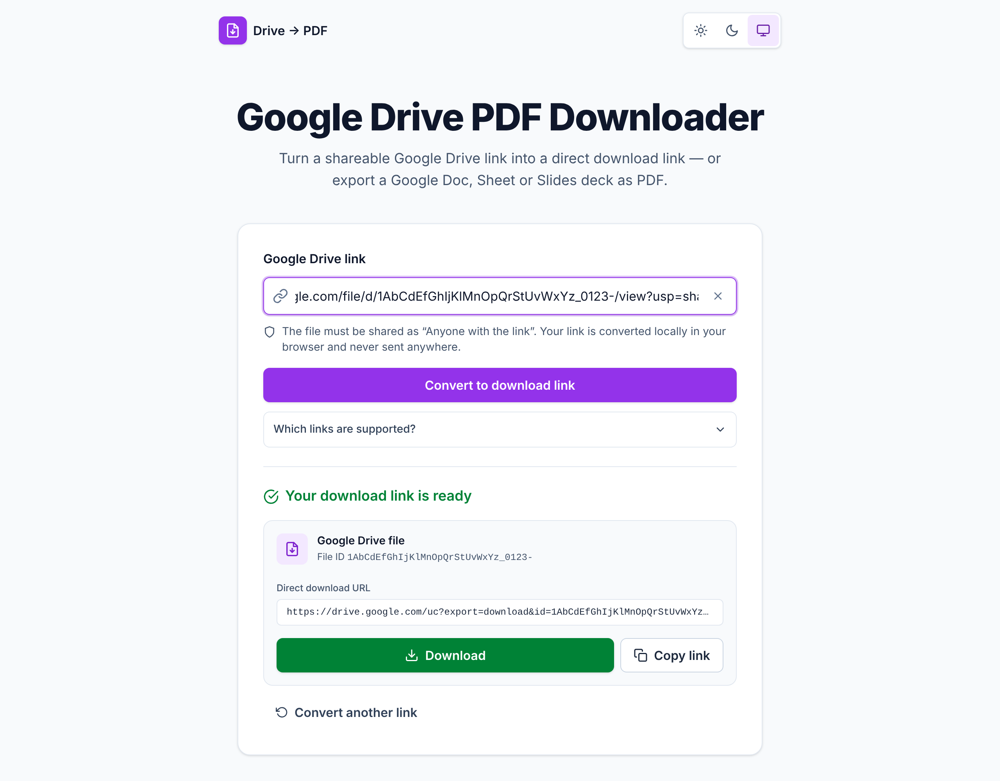
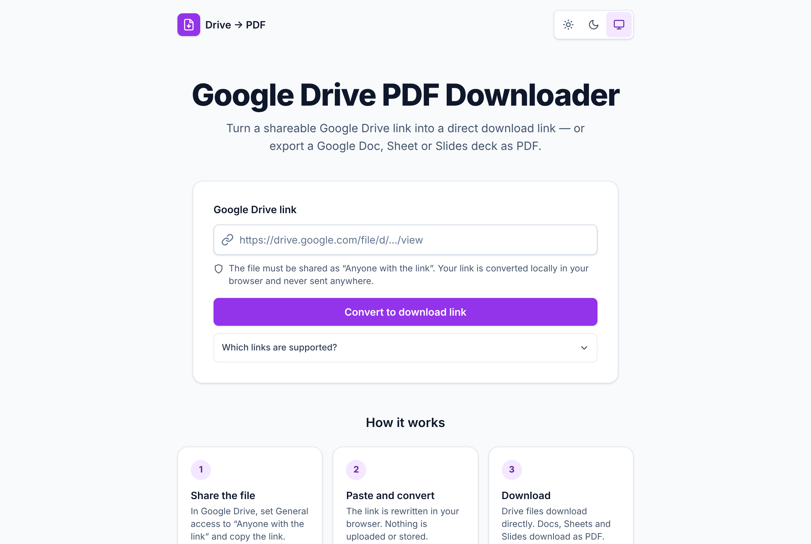
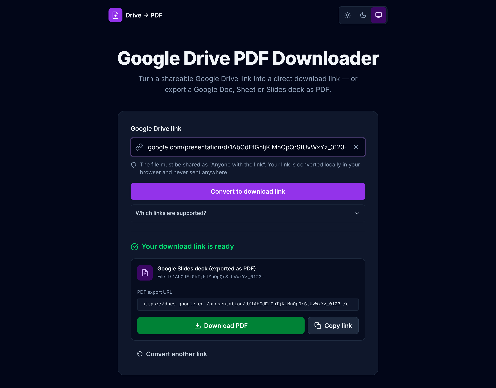
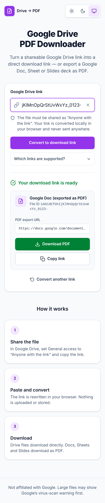
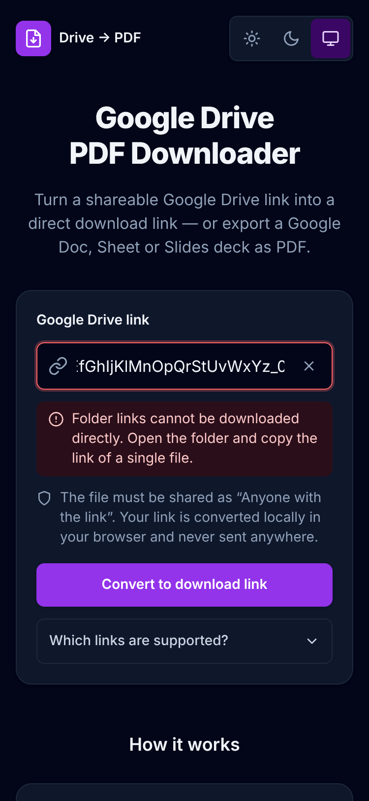
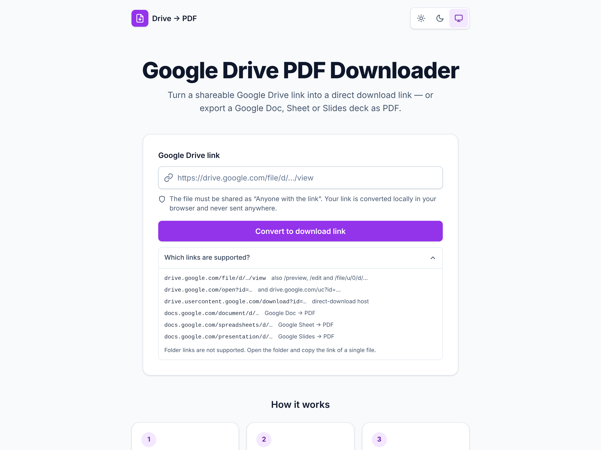
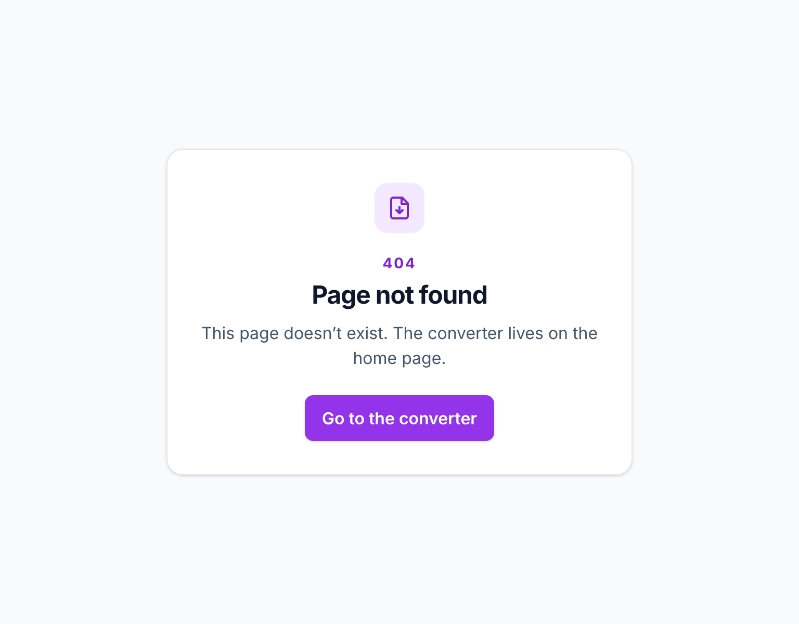
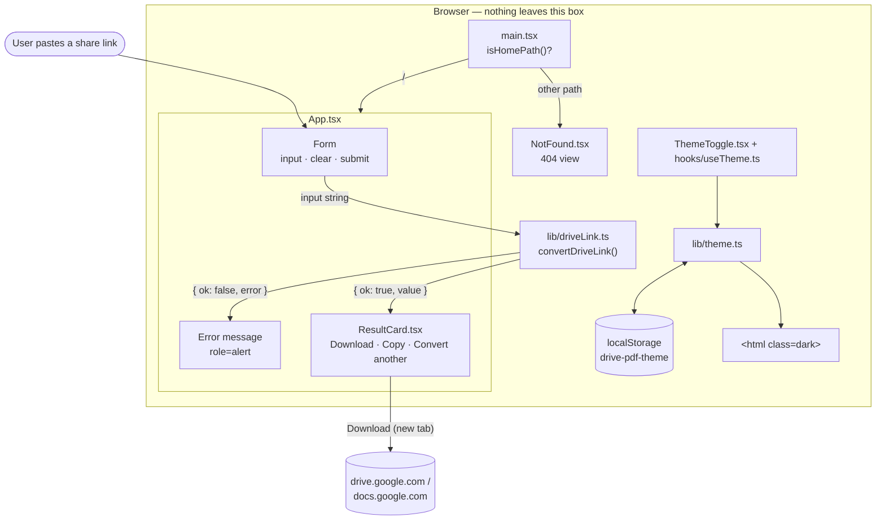

# Google Drive PDF Downloader

**Paste a Google Drive share link, get a direct download link — or a PDF export of a Google Doc,
Sheet or Slides deck. Runs entirely in your browser.**




## Contents

- [Overview](#overview)
- [Screenshots](#screenshots)
- [Features](#features)
- [Tech stack](#tech-stack)
- [Architecture](#architecture)
- [Project structure](#project-structure)
- [Getting started](#getting-started)
- [Configuration](#configuration)
- [Usage](#usage)
- [Supported link formats](#supported-link-formats)
- [Scripts](#scripts)
- [Testing](#testing)
- [Linting and formatting](#linting-and-formatting)
- [Deployment](#deployment)
- [Troubleshooting and FAQ](#troubleshooting-and-faq)
- [Known limitations](#known-limitations)
- [Roadmap ideas](#roadmap-ideas)
- [Contributing](#contributing)
- [License](#license)
- [Disclaimer](#disclaimer)

## Overview

When someone shares a file from Google Drive, the link opens Drive's preview page, not the file.
To actually download it you have to click through the viewer, and Google Docs, Sheets and Slides
don't offer a one-click PDF from a share link at all. That is awkward when you want to hand a
link to a script, `curl`, a download manager, or a person who just needs the file.

This app rewrites the share link into the URL Google itself uses for downloads:

- **Drive files** (PDFs, images, zips, anything uploaded) → `https://drive.google.com/uc?export=download&id=…`
- **Google Docs / Sheets / Slides** → their `…/export?format=pdf` (or `/export/pdf`) URL

It is for anyone who regularly shares or receives Drive files: teachers posting course material,
people embedding download buttons on a website, developers who need a stable direct link for a
script or CI job.

**Privacy:** the conversion is pure string manipulation in your browser. There is no backend, no
analytics and no network request made by the app. The only thing stored is your theme choice, in
`localStorage`.

## Screenshots

All screenshots were taken from the running app. The file ID shown is a made-up placeholder.

| Desktop, light — empty state                                        | Desktop, dark — Google Slides exported as PDF                                  |
| ------------------------------------------------------------------- | ------------------------------------------------------------------------------ |
|  |  |

| Phone, light — Google Doc result                                        | Phone, dark — folder link error                                                | Supported formats panel                                                                        |
| ----------------------------------------------------------------------- | ------------------------------------------------------------------------------ | ---------------------------------------------------------------------------------------------- |
|  |  |  |

The not-found page shown for unknown paths:



## Features

- **Direct download links for Drive files**, from every common share-link shape (see
  [Supported link formats](#supported-link-formats)).
- **PDF export for Google Workspace files**: Docs, Sheets and Slides links become PDF export URLs.
- **Keeps `resourcekey`**, which older shared files need in order to download.
- **Forgiving input**: surrounding whitespace and a missing `https://` are fine.
- **Specific, friendly validation messages** for empty input, non-URLs, non-Google hosts
  (look-alike domains such as `drive.google.com.evil.example` are rejected), folder links and links
  with no file ID.
- **Result card** with the file type, file ID, the full URL in a select-on-focus field, a
  **Download** button (opens in a new tab), **Copy link** with success/failure feedback, and
  **Convert another link** to start over.
- **Light, dark and system themes**, remembered across visits and applied before first paint so
  the page never flashes the wrong colours.
- **Accessible**: labelled input with `aria-invalid` / `aria-describedby`, `role="alert"` errors,
  live regions for the result and copy status, a skip link, a single visible focus ring, 44 px
  touch targets, WCAG AA colour contrast in both themes and `prefers-reduced-motion` support.
  Automated axe-core checks report no violations.
- **Responsive** layout checked at 375 px (phone), 768 px (tablet) and 1280 px (desktop), with no
  horizontal scrolling.
- **Not-found handling**: an in-app 404 view for unknown paths, plus a static `404.html` for hosts
  that serve one.
- **No runtime dependencies beyond React.** No CDNs, no tracking, no API keys.

## Tech stack

| Area          | Choice                                                              | Version                 |
| ------------- | ------------------------------------------------------------------- | ----------------------- |
| UI            | [React](https://react.dev)                                          | 19.3                    |
| Language      | [TypeScript](https://www.typescriptlang.org) (strict mode)          | 5.8                     |
| Build / dev   | [Vite](https://vite.dev) with `@vitejs/plugin-react`                | 6.4                     |
| Styling       | [Tailwind CSS](https://tailwindcss.com) via `@tailwindcss/vite`     | 4.3                     |
| Unit/UI tests | [Vitest](https://vitest.dev), Testing Library, jsdom                | 5.1                     |
| Linting       | ESLint 9 flat config, typescript-eslint, react-hooks, react-refresh | 9.39                    |
| Formatting    | Prettier with `prettier-plugin-tailwindcss`                         | 3.10                    |
| Runtime       | Node.js (for development and builds only)                           | ≥ 20.19, 22 recommended |

## Architecture

The app is a static single-page site. All logic lives in pure TypeScript modules with no React or
DOM dependency, and the React layer only holds form state and renders results.



How a conversion works (`src/lib/driveLink.ts`):

1. **Parse.** Trim the input, add `https://` if no scheme is present, and parse it with `URL`.
   Anything that is not `http:` or `https:` is rejected.
2. **Check the host.** Only `drive.google.com`, `drive.usercontent.google.com` and
   `docs.google.com` are accepted. The match is exact, so look-alike domains fail.
3. **Extract the ID.** Take the path segment after `/d/`, or fall back to the `id` query
   parameter. IDs must match `^[A-Za-z0-9_-]{25,128}$`.
4. **Build the URL.** Drive files get a `uc?export=download` URL (keeping `resourcekey`).
   `docs.google.com/{document,spreadsheets,presentation}` links get the matching PDF export URL.
5. **Return a result.** `convertDriveLink()` returns a discriminated union
   (`{ ok: true, value } | { ok: false, error }`), so the UI never needs `try/catch`.

Theme handling: `index.html` contains a small inline script that reads the saved preference and
sets the `dark` class before the stylesheet paints. After that, `useTheme()` owns the state, saves
changes and, in **system** mode, follows OS colour-scheme changes live. Tailwind's `dark:` variant
is bound to that class with `@custom-variant dark (&:where(.dark, .dark *))`.

## Project structure

```
.
├── index.html                    # HTML entry: title, meta/OG tags, favicon, no-flash theme script
├── public/
│   ├── 404.html                  # Static not-found page for hosts that serve one (GitHub Pages, Netlify…)
│   ├── apple-touch-icon.png      # 180×180 home-screen icon
│   └── favicon.svg
├── docs/
│   └── screenshots/              # README screenshots, captured from the running app
├── src/
│   ├── main.tsx                  # React root; renders App or NotFound based on the path
│   ├── App.tsx                   # Page layout, form state, error and result rendering
│   ├── App.test.tsx              # UI flow tests
│   ├── index.css                 # Tailwind entry, design tokens, base + component styles
│   ├── components/
│   │   ├── CopyButton.tsx        # Clipboard button with copied/failed feedback
│   │   ├── InfoSections.tsx      # "Which links are supported?" panel and "How it works" steps
│   │   ├── NotFound.tsx          # In-app 404 view
│   │   ├── ResultCard.tsx        # Success state: file info, URL, Download / Copy / Convert another
│   │   ├── ThemeToggle.tsx       # Light / dark / system switch
│   │   ├── ThemeToggle.test.tsx
│   │   └── icons.tsx             # Inline SVG icon set (decorative, aria-hidden)
│   ├── hooks/
│   │   └── useTheme.ts           # Theme state, persistence and OS-change listener
│   ├── lib/
│   │   ├── driveLink.ts          # Core: link parsing, validation and URL building (pure)
│   │   ├── driveLink.test.ts
│   │   ├── route.ts              # isHomePath(): decides between App and NotFound
│   │   ├── route.test.ts
│   │   └── theme.ts              # Read/save/apply theme preference (pure helpers)
│   └── test/setup.ts             # jest-dom matchers + cleanup for Vitest
├── eslint.config.js              # ESLint 9 flat config
├── vite.config.ts                # Vite + Vitest config (dev server on port 3000)
├── tsconfig.json                 # Strict TypeScript settings
├── .prettierrc.json              # Prettier + Tailwind class sorting
├── .editorconfig
└── .nvmrc                        # Node 22
```

## Getting started

### Prerequisites

- **Node.js 20.19 or newer** (22 LTS recommended; `.nvmrc` pins 22). Check with `node -v`.
- **npm** (bundled with Node). The lockfile is `package-lock.json`.
- Any modern browser.

### Installation

```bash
# 1. Clone the repository
git clone https://github.com/jeevithg090/Drive_To_PDF.git
cd Drive_To_PDF

# 2. Use the pinned Node version (optional, if you use nvm)
nvm use

# 3. Install exact dependency versions from the lockfile
npm ci

# 4. Start the dev server
npm run dev
```

Open <http://localhost:3000>. Vite hot-reloads changes as you edit.

### Running in production mode

```bash
npm run build      # type-checks with tsc, then bundles to dist/
npm run preview    # serves dist/ on http://localhost:4173
```

`dist/` is a plain static site. Serve it with any static file server or host (see
[Deployment](#deployment)). The production bundle is about 75 kB of JavaScript and 6 kB of CSS
after gzip.

## Configuration

The app needs **no environment variables**, API keys or backend services. There is no `.env` file
to create.

| Variable | Required | Default | Description                                                    |
| -------- | -------- | ------- | -------------------------------------------------------------- |
| _(none)_ | —        | —       | The app is fully static; all behaviour is fixed at build time. |

The few things you might want to change live in code:

| Setting           | Where                               | Default           | Notes                                                      |
| ----------------- | ----------------------------------- | ----------------- | ---------------------------------------------------------- |
| Dev server port   | `vite.config.ts` → `server.port`    | `3000`            | `vite preview` uses Vite's default, `4173`.                |
| Public base path  | `vite.config.ts` → `base` (not set) | `/`               | Set for sub-path hosting, e.g. GitHub Pages project sites. |
| Theme storage key | `src/lib/theme.ts` and `index.html` | `drive-pdf-theme` | Keep both in sync if you rename it.                        |
| Brand colours     | `src/index.css` → `@theme`          | Purple            | `--color-brand-50` … `--color-brand-950`.                  |

## Usage

### In the browser

1. In Google Drive, open the file's **Share** dialog and set **General access** to
   **Anyone with the link**. Copy the link.
2. Paste it into the **Google Drive link** field and press **Enter** or click
   **Convert to download link**.
3. In the result card:
   - **Download** (or **Download PDF** for Docs/Sheets/Slides) opens the download in a new tab.
   - **Copy link** puts the URL on your clipboard. The button shows **Copied!** or
     **Copy failed**.
   - **Convert another link** clears the form and returns focus to the input.
4. If the link can't be converted, a message under the field says why. Fix the link and submit
   again; the message clears as soon as you start typing.

Use the sun / moon / monitor buttons in the header to choose light, dark or system theme.

### Examples

These use a placeholder ID; real IDs come from your own share links.

| You paste                                                        | You get                                                                    |
| ---------------------------------------------------------------- | -------------------------------------------------------------------------- |
| `https://drive.google.com/file/d/FILE_ID/view?usp=sharing`       | `https://drive.google.com/uc?export=download&id=FILE_ID`                   |
| `drive.google.com/open?id=FILE_ID`                               | `https://drive.google.com/uc?export=download&id=FILE_ID`                   |
| `https://drive.google.com/file/d/FILE_ID/view?resourcekey=0-abc` | `https://drive.google.com/uc?export=download&id=FILE_ID&resourcekey=0-abc` |
| `https://docs.google.com/document/d/FILE_ID/edit`                | `https://docs.google.com/document/d/FILE_ID/export?format=pdf`             |
| `https://docs.google.com/spreadsheets/d/FILE_ID/edit#gid=0`      | `https://docs.google.com/spreadsheets/d/FILE_ID/export?format=pdf`         |
| `https://docs.google.com/presentation/d/FILE_ID/edit`            | `https://docs.google.com/presentation/d/FILE_ID/export/pdf`                |

The generated URL works anywhere a URL does, for example:

```bash
# -L follows Google's redirect to the actual file
curl -L -o report.pdf "https://docs.google.com/document/d/FILE_ID/export?format=pdf"
```

### Error messages

| Input                                       | Message                                                                                         |
| ------------------------------------------- | ----------------------------------------------------------------------------------------------- |
| Empty                                       | Please enter a Google Drive link.                                                               |
| Not parseable as a URL / non-http(s) scheme | That does not look like a valid URL.                                                            |
| Any host other than the three Google hosts  | Only drive.google.com and docs.google.com links are supported.                                  |
| `…/drive/folders/…`                         | Folder links cannot be downloaded directly. Open the folder and copy the link of a single file. |
| Google host but no valid file ID            | Could not find a file ID in that link. Make sure it is a link to a single file.                 |

### Using the converter from code

The core module has no React or DOM dependency, so it can be reused directly:

```ts
import { convertDriveLink } from './src/lib/driveLink';

const result = convertDriveLink('https://docs.google.com/document/d/FILE_ID/edit');
if (result.ok) {
  console.log(result.value);
  // { kind: 'document', fileId: 'FILE_ID', downloadUrl: 'https://docs.google.com/document/d/FILE_ID/export?format=pdf' }
} else {
  console.error(result.error);
}
```

(`FILE_ID` here stands for a real 25+ character ID; shorter strings are rejected.)

There is no HTTP API: the app has no backend.

## Supported link formats

| Format                                                                    | Result            |
| ------------------------------------------------------------------------- | ----------------- |
| `drive.google.com/file/d/<id>/view` (also `/preview`, `/edit`, no suffix) | Direct download   |
| `drive.google.com/file/u/<n>/d/<id>/view` (multi-account)                 | Direct download   |
| `drive.google.com/open?id=<id>`                                           | Direct download   |
| `drive.google.com/uc?id=<id>` (with or without `export=download`)         | Direct download   |
| `drive.usercontent.google.com/download?id=<id>`                           | Direct download   |
| `docs.google.com/file/d/<id>` (legacy)                                    | Direct download   |
| `docs.google.com/document/d/<id>/…`                                       | PDF export        |
| `docs.google.com/spreadsheets/d/<id>/…`                                   | PDF export        |
| `docs.google.com/presentation/d/<id>/…`                                   | PDF export        |
| `drive.google.com/drive/folders/<id>`                                     | Rejected (folder) |

`http://` links, upper-case hosts, extra query parameters and fragments are accepted.

## Scripts

| Command                | What it does                                                   |
| ---------------------- | -------------------------------------------------------------- |
| `npm run dev`          | Start the Vite dev server on <http://localhost:3000>           |
| `npm run build`        | Type-check with `tsc`, then build the static site into `dist/` |
| `npm run preview`      | Serve the production build on <http://localhost:4173>          |
| `npm test`             | Run the whole test suite once                                  |
| `npm run test:watch`   | Run tests in watch mode                                        |
| `npm run lint`         | Lint all TypeScript with ESLint                                |
| `npm run typecheck`    | Type-check without emitting files                              |
| `npm run format`       | Format everything with Prettier                                |
| `npm run format:check` | Check formatting without writing (useful before committing)    |

## Testing

```bash
npm test             # single run
npm run test:watch   # re-run on change
npx vitest run src/lib/driveLink.test.ts   # one file
```

Tests run in Vitest with jsdom and Testing Library. There are 52 tests in four files:

| File                                  | Tests | Covers                                                                                                                                                                                                      |
| ------------------------------------- | ----- | ----------------------------------------------------------------------------------------------------------------------------------------------------------------------------------------------------------- |
| `src/lib/driveLink.test.ts`           | 32    | Every supported link format, `resourcekey`, whitespace/scheme tolerance, rejected hosts and schemes, folders, bad IDs, URL builders                                                                         |
| `src/App.test.tsx`                    | 11    | Empty/invalid input errors and `aria-invalid`, error clearing, Drive and Docs results, Enter to submit, result reset, clipboard success and failure, clear button, "Convert another link", focus management |
| `src/lib/route.test.ts`               | 6     | Home vs not-found path detection, including sub-path bases                                                                                                                                                  |
| `src/components/ThemeToggle.test.tsx` | 3     | Default system theme, applying and persisting choices, restoring a saved choice, ignoring bad values                                                                                                        |

Before release, the UI was also checked in a real browser (headless Chromium via Playwright) at
375 px, 768 px and 1280 px in both themes: no console errors, no horizontal scroll, keyboard tab
order, visible focus, theme persistence across reloads and an axe-core audit with no violations.
Those browser checks are not part of `npm test`.

## Linting and formatting

- **ESLint** (`eslint.config.js`): `@eslint/js` recommended, typescript-eslint recommended,
  react-hooks rules and react-refresh's export check.
- **Prettier** (`.prettierrc.json`): single quotes, 100-column lines, trailing commas, and
  Tailwind class sorting via `prettier-plugin-tailwindcss`.
- **TypeScript**: `strict`, `noUncheckedIndexedAccess`, `noUnusedLocals`/`Parameters`,
  `verbatimModuleSyntax`.

A good pre-commit check:

```bash
npm run lint && npm run typecheck && npm run format:check && npm test
```

## Deployment

`npm run build` produces a static site in `dist/` — `index.html`, hashed assets, the icons and
`404.html`. No server code, no environment variables. Upload `dist/` to any static host:

| Host             | Build command   | Output dir | Notes                                                                                 |
| ---------------- | --------------- | ---------- | ------------------------------------------------------------------------------------- |
| Netlify          | `npm run build` | `dist`     | Serves `404.html` automatically.                                                      |
| Vercel           | `npm run build` | `dist`     | Detects Vite automatically.                                                           |
| Cloudflare Pages | `npm run build` | `dist`     | Serves `404.html` automatically.                                                      |
| GitHub Pages     | `npm run build` | `dist`     | For a project site (`/<repo>/`), set `base` (below). Serves `404.html` automatically. |
| Any web server   | `npm run build` | `dist`     | nginx, Apache, S3 + CloudFront, `npx serve dist`…                                     |

**Serving from a sub-path** (for example `https://<user>.github.io/Drive_To_PDF/`): set the base in
`vite.config.ts`:

```ts
export default defineConfig({
  base: '/Drive_To_PDF/',
  // …
});
```

The in-app not-found view and the main app respect `base`. The static `public/404.html` uses
root-relative links (`/` and `/favicon.svg`), so update those two links to the sub-path too.

If your host rewrites every path to `index.html`, unknown paths show the in-app 404 view instead.

This repository does not ship a CI or deployment workflow; pick whichever host suits you.

## Troubleshooting and FAQ

**The download opens a Google sign-in or "You need access" page.**
The file isn't shared publicly. In Drive, set General access to **Anyone with the link**. Files
restricted to an organisation only download for signed-in members of that organisation.

**Google shows "can't scan this file for viruses" instead of downloading.**
For large files (roughly 100 MB and up) Google shows this confirmation page. Click
**Download anyway**. The app cannot skip it because that page comes from Google.

**"Too many users have viewed or downloaded this file recently."**
Google rate-limits popular files. Wait, or ask the owner to make a copy and share that.

**The PDF export of a Sheet looks cramped or cuts off columns.**
The PDF uses Google's default export settings. For control over orientation, scaling and ranges,
use **File → Download → PDF** inside Sheets.

**My link was rejected.**
Make sure you copied the full link, including the long file ID. Shortened links (e.g. `bit.ly`)
are rejected as non-Google hosts; open them first and copy the final Drive URL.

**Folder links don't work.**
Drive offers no direct-download URL for a folder. Open the folder and copy a single file's link.

**Copy link says "Copy failed".**
The browser blocked clipboard access, which happens on non-HTTPS origins (other than `localhost`)
and in some embedded browsers. Select the URL field (it selects all on focus) and copy manually.

**`npm ci` fails with an engine error.**
Use Node 20.19+ (`nvm use` picks up `.nvmrc`).

**Port 3000 is already in use.**
Run `npm run dev -- --port 5173`, or change `server.port` in `vite.config.ts`.

**The theme keeps resetting.**
The preference is stored in `localStorage`. Private browsing modes or blocked site data discard it;
the app then falls back to your system theme.

## Known limitations

- The app only rewrites URLs. It can't make a private file downloadable, bypass Google's
  virus-scan page, quotas or rate limits, or check that a file exists before you click Download.
- Google may change its download or export URL formats at any time.
- Google Forms, Drawings, Sites and folders have no supported export here.
- PDF export always uses Google's default export options (no page size, orientation or range).
- Supported formats were built from Google's documented and observed URL patterns; real downloads
  depend on Google's servers and the file's sharing settings.

## Roadmap ideas

Not commitments, just directions that would fit the app:

- Other export formats for Workspace files (DOCX, XLSX, PPTX, CSV for a single sheet, PNG for
  slides).
- Batch mode: paste several links and convert them all at once.
- A browser extension or bookmarklet that converts the current Drive tab.
- Sheet export options (orientation, fit-to-width, gridlines) exposed as toggles.
- A small published npm package for `convertDriveLink()`.

## Contributing

Issues and pull requests are welcome.

1. Fork the repository and create a branch from `main`.
2. `npm ci`, then make your change. Keep link-parsing logic in `src/lib/` and free of React/DOM
   code, and add tests for any new link format or error case.
3. Run `npm run lint && npm run typecheck && npm run format:check && npm test` and make sure
   `npm run build` succeeds.
4. Check the UI at phone and desktop widths in both themes, using only the keyboard as well as the
   mouse.
5. Use [Conventional Commits](https://www.conventionalcommits.org) (`feat:`, `fix:`, `docs:` …)
   and describe what you changed and how you verified it in the pull request.

## License

No license file has been added yet, so all rights are reserved by default. If you intend others to
reuse the code, adding a permissive license such as **MIT** is recommended.

## Disclaimer

This project is not affiliated with, endorsed by or sponsored by Google. "Google Drive", "Google
Docs", "Google Sheets" and "Google Slides" are trademarks of Google LLC. The app only rewrites URLs;
access to any file is governed by the sharing settings its owner chose in Google Drive.
